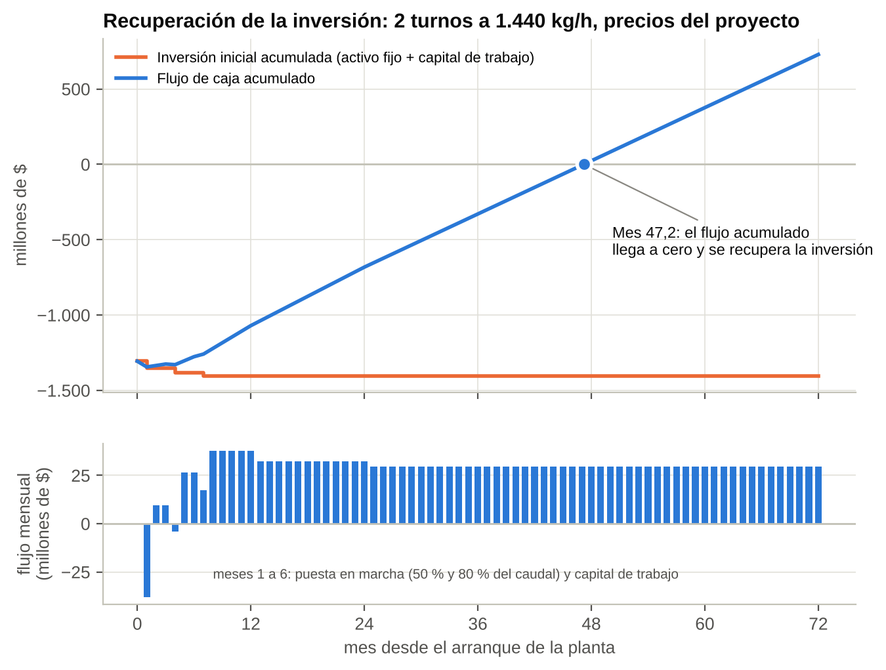
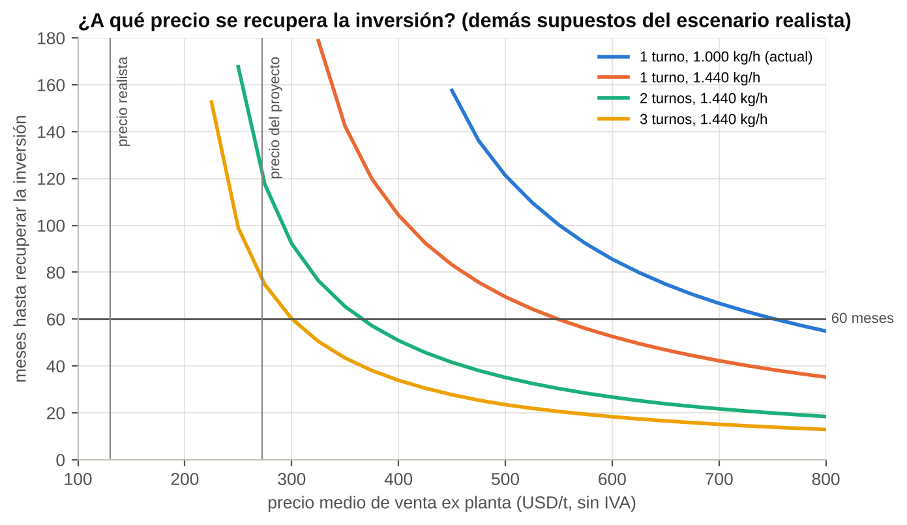

# Análisis de rentabilidad y recuperación de la inversión

Anexo económico del proyecto final: **¿cuánto dinero genera realmente la secadora de guano y en cuánto tiempo se
recupera la inversión?** Pesos constantes de noviembre de 2026, sin IVA, dólar BNA $ 1.575. Planta de secado sin biogás,
la primera etapa que recomienda el proyecto.

| Archivo | Contenido |
|---|---|
| [Analisis_economico_Secadora_Guano.pdf](Analisis_economico_Secadora_Guano.pdf) | Informe completo: inversión, capacidad, costos, ingresos, payback, ROI, punto de equilibrio, escenarios, sensibilidad, análisis inverso de capacidad y conclusión |
| [Analisis_economico_Secadora_Guano.docx](Analisis_economico_Secadora_Guano.docx) | El mismo informe en Word |
| [Modelo_economico_Secadora_Guano.xlsx](Modelo_economico_Secadora_Guano.xlsx) | Planilla con fórmulas: se elige el escenario y se cambian los datos en azul; recalcula el flujo de 180 meses, los impuestos y los indicadores |
| [figuras/](figuras/) | Los ocho gráficos del informe |

## Resultados con la secadora tal como fue diseñada (1 turno, 1.000 kg/h)

| | Conservador | Realista | Optimista |
|---|---:|---:|---:|
| Inversión inicial total | $ 1.626 M (USD 1.032.124) | $ 1.360 M (USD 863.534) | $ 1.256 M (USD 797.561) |
| Guano húmedo procesado | 1.690 t/año | 1.840 t/año | 2.006 t/año |
| Producto seco vendido | 386 t/año | 535 t/año | 666 t/año |
| Precio medio ex planta | USD 38,5/t | USD 130,1/t | USD 272,5/t |
| Ventas | $ 1,9 M/mes | $ 9,1 M/mes | $ 23,8 M/mes |
| Costos operativos | $ 21,9 M/mes | $ 19,9 M/mes | $ 16,6 M/mes |
| Flujo de caja neto de régimen | $ −239 M/año | $ −130 M/año | $ 87 M/año |
| Recuperación de la inversión | no recupera | no recupera | no recupera |
| ROI anual (año 2) | −21,7 % | −16,7 % | −0,5 % |

**Con un turno la planta no recupera la inversión en ningún escenario.** El costo operativo de un kilogramo vendido es
de $ 447 (realista), más que el precio que se puede respaldar hoy: el único precio de granel
encontrado es de USD 30/t para guano semiseco (2024) y el valor de los nutrientes del producto es de
USD 83,5/t; el proyecto supuso USD 272,5/t sin cotizaciones.

## Capacidad mínima para recuperar la inversión en 5 años

Con los precios y demás supuestos del escenario optimista alcanza con **2 turnos a 1.213 kg/h**
(406 t/mes de guano húmedo y 1.615 t/año de producto vendido), con la misma
máquina: con el aire hasta 135 °C seca hasta 1.440 kg/h. Cuesta USD 32.000 (segundo turno y tolva de retención mayor). A
1.440 kg/h recupera en 47,2 meses. Tres turnos también alcanzan (919 kg/h), con más
guano por día. Con los precios del proyecto pero los demás supuestos del escenario realista, dos turnos a 1.440 kg/h tardan
121 meses; con el precio realista haría falta vender a unos
USD 366/t.

## Datos pendientes antes de invertir

1. Precio mayorista y volumen que compra el mercado (cartas de intención de compradores).
2. Tarifa real de la Cooperativa La Agrícola Regional.
3. Cáscara de arroz puesta en planta y quién paga el flete del guano.

## Cómo se regenera

`python fuente/regenerar.py economia` rehace el modelo (`fuente/economia/modelo_economico.py`), los gráficos, la planilla
y el informe. La planilla repite el modelo con fórmulas de Excel; su hoja «Indicadores» compara los resultados con los
de Python (diferencia cero en los tres escenarios).
