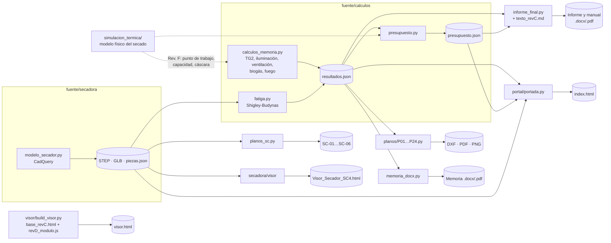

# Arquitectura del proyecto

El repositorio no es una aplicación con servidor. Es una **entrega técnica generada por programas**: todo lo que se ve
(planos, informe, memoria, presupuesto, modelos 3D, visores, portada y video) sale de programas en `fuente/`. Los
datos se escriben **una sola vez**, en los cálculos.

## Flujo de datos

## Componentes

| Componente | Tecnología | Entrada | Salida |
|---|---|---|---|
| Cálculos | Python, solo la biblioteca estándar | constantes con su fuente, dentro del código | `resultados.json`, `presupuesto.json`, planilla Excel (openpyxl) |
| Láminas P01-P24 | ezdxf → DXF; render a PDF A3 y PNG con PyMuPDF | `resultados.json`, `datos/layout_planta.json` | `planos/dxf`, `planos/pdf`, `planos/*.png` |
| Secador SC-4 | CadQuery (OpenCASCADE, sólidos exactos) | medidas como parámetros con nombre | STEP, GLB, `piezas.json` (68 piezas con masa y despiece) |
| Láminas SC-01 a SC-06 | ezdxf, con proyecciones con líneas ocultas (OCP) | modelo CadQuery | DXF, PDF, PNG |
| Informe, memoria y manual | python-docx; el PDF se imprime con Chrome desde un HTML equivalente | `texto_revC.md` y los JSON | `.docx` y `.pdf` |
| Visor de la planta | three.js r163 compilado (Rev. C) + módulo `revD_modulo.js` inyectado | geometría paramétrica | `visor.html`, un solo archivo que anda sin internet |
| Visor del secador | three.js r170 (ESM) empaquetado con esbuild | GLB y `pasos_montaje.json` | `secadora/Visor_Secador_SC4.html` |
| Estudio térmico | Python + numba (núcleo compilado), matplotlib; simulador en JavaScript | datos del informe y ensayos publicados | `resultados/*.json`, `figuras/*.png`, `simulador.html` |
| Portada | Python, plantilla HTML con claves `{{…}}` | los JSON, los tamaños de los archivos, los PNG de las láminas | `index.html`, `entrega.html` (redirección), miniaturas y ZIP de los DXF |
| Video | three.js cuadro por cuadro con Chrome sin ventana, ffmpeg | geometría del visor, mapa satelital, guion | MP4 (la versión pública va sin música) |

## Decisiones de diseño

- **Una sola fuente de verdad por dato.** Un número se cambia en el programa de cálculo y se regenera
  (`fuente/regenerar.py`). Las pruebas (`tests/`) fallan si algún documento quedó con un valor viejo.
- **Archivos autónomos.** Los visores y el simulador son un solo HTML que anda sin internet: es una entrega escolar
  que se tiene que poder abrir con doble clic en la compu de la escuela.
- **Sitio estático.** La publicación no necesita servidor ni base de datos ni variables de entorno: GitHub Pages
  sirve los mismos archivos del repositorio por HTTPS.
- **Rev. C intacta dentro del visor.** `base_revC.html` es el visor entregado en la Rev. C (código compilado). Los
  cambios posteriores se inyectan con `build_visor.py`, por reemplazos que fallan si el original cambia.

## Límites conocidos

- `base_revC.html` está compilado (minificado) y no hay fuente legible. Para cambiarlo se agregan reemplazos
  controlados en `build_visor.py`, o geometría nueva en `revD_modulo.js`.
- Los PDF de las láminas no tienen capa de texto: ezdxf dibuja el texto como trazos. El texto buscable está en los DXF.
- El render del video necesita datos que no se guardan en el repositorio: el mapa satelital (unos 100 MB de
  teselas) y la música, que no es libre de derechos. Los rehacen `fuente/video/mapa.py` y `ritmo.py`.
